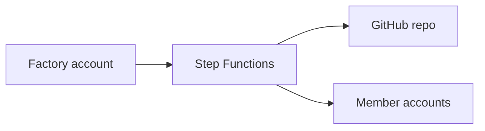

# AWS Project Factory

Self-hosted control plane that creates GitHub repositories and AWS Organization accounts from one admin account. You run it in **your** AWS account. It is not a hosted service.

Keywords: project factory, SST, AWS Organizations, IAM Identity Center, SvelteKit, AppSync.

- **Frontend**: SvelteKit 2 + TypeScript + Tailwind CSS
- **Backend**: AWS AppSync (GraphQL) with JavaScript resolvers
- **Database**: DynamoDB (single-table design)
- **Authentication**: AWS Cognito User Pools
- **Infrastructure**: [sst-community](https://github.com/sst-community/sst) 4.25.0 (built on SST 4.17.2) with Pulumi
- **Monorepo**: pnpm workspaces + Turborepo

Full setup checklist: [docs/ADOPTION.md](docs/ADOPTION.md).



## What it does

Creating a project starts a Step Functions workflow:

1. Generates a GitHub repo from a template you choose (`owner/repo`).
2. Optionally vends new AWS accounts with Organizations `CreateAccount`, or bootstraps accounts that already exist in the organization.
3. Creates a GitHub OIDC deploy role in each account and can assign an IAM Identity Center group so the account shows up in your SSO portal.
4. Writes GitHub Environments, secrets, and `deploy:*` labels for each environment (`int`, `stage`, `prod`, or suffixes you set).

This repository itself deploys as **one** stack in **one** admin account (SST stage `admin`). Child projects use their own accounts.

## Security

The factory can create AWS accounts, assume `OrganizationAccountAccessRole`, write IAM roles, and read a GitHub App private key from Secrets Manager. Deploy it only in an account you control, with credentials limited to people who should be able to create accounts. See [SECURITY.md](SECURITY.md).

A signed-in Cognito user can close an organization account that is not the management account. GitHub deploy roles stay on `AdministratorAccess` so a child stack can deploy. A permissions boundary on those roles blocks closing the account, changing the organization, and removing the boundary. When custom DNS is on, the apps DNS role can be assumed only by `GitHubActions-*` roles in this AWS Organization.

Vended accounts are billable. Account creation is slow (often many minutes) and is not rolled back if a later step fails.

## Prerequisites

- Node.js 22 and pnpm 10
- An AWS **management** account with Organizations enabled
- IAM Identity Center, if you want new accounts to appear in the SSO portal
- A GitHub App installed on the org that will own child repos, plus a template repository
- AWS CLI credentials for that admin account (`AWS_PROFILE_ADMIN`)

Copy [`.env.example`](.env.example) and fill in the values you need before the first deploy.

## Quick start

```bash
pnpm install
aws sso login --sso-session=acme   # change the session name to yours
export AWS_PROFILE_ADMIN=acme-admin
pnpm run deploy
```

`pnpm deploy` is a pnpm built-in and does **not** run this repo's deploy script. Use `pnpm run deploy`.

`pnpm dev` runs SST dev (deploys the stack and starts the admin UI with hot reload).

The `sso` script in `package.json` calls `aws sso login --sso-session=acme`. Change `acme` to your SSO session, or log in with the AWS CLI directly.

### Example AWS profile

```ini
[sso-session acme]
sso_start_url  = https://acme.awsapps.com/start
sso_region     = us-east-1

[profile acme-admin]
sso_session    = acme
sso_account_id = 111111111111
sso_role_name  = AdministratorAccess
region         = us-east-1
```

## Before the first project

1. Store the GitHub App id and installation id in SSM, and the app private key in Secrets Manager. Commands are in [docs/ADOPTION.md](docs/ADOPTION.md).
2. Store the Identity Center group id at `/admin-factory/identity-center-group-id` if you want SSO assignment. If that parameter is missing at deploy time, the stack cannot read it.
3. Set `VITE_DEFAULT_TEMPLATE_REPO` (`owner/repo`) and, if you vend accounts, `VITE_ACCOUNT_EMAIL_LOCAL` plus `VITE_ACCOUNT_EMAIL_DOMAIN`.
4. Optional custom DNS: set `FACTORY_ROOT_DOMAIN` and `FACTORY_ADMIN_HOSTED_ZONE_ID` together. Leave both unset to use the hostname SST assigns.

## Child templates

The new-project form sends a GitHub template repository (`owner/repo`). There is no built-in template. Mark your starter as a template repository (Settings → General → Template repository) and make sure the GitHub App can read it.

`rename-project.ts` rewrites these placeholders when they are still present: `@sst-monorepo`, `sst-monorepo-starter`, and `acme`. Templates that use the same placeholders work with one rename pass. Paths that are missing in a given template are skipped.

When the factory configures a child repo it:

1. Renames those placeholders
2. Creates a GitHub Environment per AWS account
3. Sets `AWS_ROLE_ARN`, optional `DNS_ROLE_ARN`, `APP_URL`, and `APPS_HOSTED_ZONE_ID`
4. Sets the `DEPLOY_ENV_ORDER` repository variable
5. Creates `deploy:*` and `deploy-failed:*` labels
6. Leaves `.github/workflows/deploy.yml` as it is in the template

GitHub App permissions used on child repos: Contents (read/write), Environments, Secrets, Variables, Metadata.

## Optional custom domain

| Variable | Purpose |
|----------|---------|
| `FACTORY_ROOT_DOMAIN` | Apex, for example `example.com` |
| `FACTORY_ADMIN_HOSTED_ZONE_ID` | Route 53 zone id for that apex |
| `PROJECT_APPS_HOSTED_ZONE_ID` | Zone id of `apps.<apex>`, required for SST stages other than `admin` |

When both factory domain variables are set, the admin UI is `admin.<apex>` and project apps use `apps.<apex>`. The `admin` stage creates the delegated `apps` zone. Copy `projectAppsHostedZoneId` from the deploy output into `PROJECT_APPS_HOSTED_ZONE_ID` before you deploy any other stage name.

## Environment

| Item | Value |
|------|--------|
| SST stage | `admin` (default) |
| AWS account | The credentials in `AWS_PROFILE_ADMIN`, `AWS_PROFILE`, or `default` |
| Removal policy | `retain` for stage `admin`; `remove` for any other stage name |

## Project structure

```
├── apps/admin          SvelteKit admin UI
├── packages/core       Shared types and utilities
├── packages/functions  Lambda handlers
├── packages/graphql    GraphQL schema and codegen
├── infra/              SST modules (AppSync, Cognito, DynamoDB, provisioning)
├── sst.config.ts       Single admin stage
└── .github/workflows   CI and label-driven deploy
```

`@admin/*`, `apps/admin`, and SST stage `admin` are the control plane. The product name is AWS Project Factory.

## GitHub Actions

CI runs on pull requests and pushes to `main` / `develop`: lint, typecheck, test, and build.

Deploy runs when an open pull request gets the label `deploy:admin`. It uses the GitHub Environment `admin` and the `AWS_ROLE_ARN` secret (OIDC role in your admin account). No long-lived AWS keys belong in GitHub.

Trust policy sketch:

```json
"Condition": {
  "StringEquals": {
    "token.actions.githubusercontent.com:aud": "sts.amazonaws.com"
  },
  "StringLike": {
    "token.actions.githubusercontent.com:sub": [
      "repo:<org>/<repo>:environment:admin"
    ]
  }
}
```

| Label | Purpose |
|-------|---------|
| `deploy:admin` | Deploy the admin stack |

## GraphQL codegen

After editing `packages/graphql/schema.graphql`:

```bash
pnpm codegen
```

## Environment variables

See [`.env.example`](.env.example). `pnpm dev` injects stack outputs (`VITE_USER_POOL_ID`, `VITE_GRAPHQL_ENDPOINT`, and the rest) from SST. Values such as the template repo and account-email domain are read from the environment at deploy time and baked into the admin app.

## Database

Single-table DynamoDB. Primary key `PK` + `SK`. `GSI1` is user-centric. `GSI2` is used for global lookups such as project slugs.

## Cost

The admin stack (DynamoDB, AppSync, Cognito, Lambda, CloudFront) is often within free tier for a small team, on the order of $0–20/month.

Each **vended member account** is a separate AWS account and is billed for whatever you deploy in it. Organizations account creation is not covered by that admin-stack estimate.

## License

[MIT](LICENSE)
